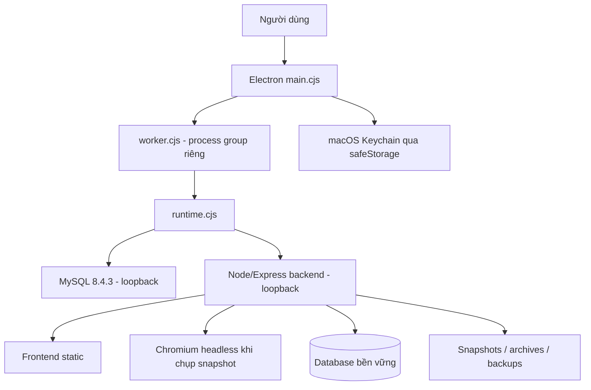

# Tài liệu kỹ thuật Dunnio Insights 1.5.0 cho macOS

Tài liệu này mô tả bản macOS được build từ repository `dunnio-user-behavior-tracker`, commit và checksum được ghi trong manifest của từng bản bàn giao. Phạm vi gồm launcher desktop, vòng đời tiến trình, backend, database, frontend, SDK thu thập, bảo mật, build, kiểm thử và các điểm cần sửa khi phát triển tiếp.

## 1. Mục tiêu và phạm vi

Dunnio Insights là ứng dụng phân tích hành vi gồm ba luồng chính:

1. **Dunnio Touch** nhận sự kiện first-party đã có consent, tổng hợp theo ngày và hiển thị heatmap tọa độ/phần tử.
2. **Clarity Workspace** quản lý quy trình nhập CSV/PNG xuất từ Microsoft Clarity và so sánh nhiều khoảng ngày.
3. **Behavior Tracker đời trước** giữ luồng event chi tiết, snapshot và ghi chú cải thiện nội dung để tương thích dữ liệu hiện có.

Bản macOS dùng chung Express, MySQL, migrations, frontend và tracker với bản Windows. Phần khác biệt nằm trong `desktop/macos`: Electron quản lý cửa sổ/Keychain; một worker riêng quản lý Node backend, MySQL và Chromium.

Yêu cầu runtime của gói đã build:

- macOS 14 trở lên.
- `arm64` cho Apple Silicon; `x64` cho Intel.
- Không yêu cầu Homebrew, Node, MySQL hoặc Chrome cài ngoài.
- Không cần `sudo`; dữ liệu thuộc tài khoản macOS đang chạy ứng dụng.
- Preview 1.5.0 dùng chữ ký ad-hoc, chưa notarized bằng Apple Developer ID.

## 2. Cây thư mục source

```text
source-code/
├── .github/workflows/macos.yml       # CI build/test/release hai kiến trúc
├── backend/
│   ├── migrations/001..013.sql       # Schema có version
│   ├── scripts/                      # Capture, archive, maintenance, load test
│   ├── src/
│   │   ├── config/                   # MySQL pool
│   │   ├── desktop/                  # API điều khiển local, setup, shutdown
│   │   ├── middleware/               # JWT, role, error handling
│   │   ├── models/                   # Lớp dữ liệu legacy
│   │   ├── routes/                   # REST API
│   │   └── services/                 # Logic heatmap/Clarity/archive/catalog
│   ├── test/                         # Unit, integration và browser tests
│   └── package.json
├── desktop/
│   ├── launcher/                     # Launcher Windows, không chạy trên Mac
│   └── macos/
│       ├── main.cjs                  # Electron main process
│       ├── worker.cjs                # Guardian/IPC worker
│       ├── runtime.cjs               # MySQL + backend lifecycle
│       ├── security.cjs              # Keychain/settings/path validation
│       ├── preload.cjs               # Bridge cấu hình giới hạn
│       ├── configuration.*           # UI nhập Clarity token
│       ├── build.cjs                 # Chuẩn bị payload/runtime
│       ├── smoke.cjs                 # Test app đã đóng gói
│       ├── vendor-lock.json           # URL + SHA-256 MySQL theo kiến trúc
│       ├── package.json               # Electron Builder
│       └── test/                      # Test lifecycle/security
├── frontend/                         # HTML/CSS/JS được backend phục vụ
├── tracker/                          # SDK nhúng vào website
├── deployment/                       # Docker/Caddy cho collector HTTPS
├── design-system/                    # Quy chuẩn UI Dunnio Touch
├── planning-docs/                    # Thiết kế và biên bản kỹ thuật
├── LICENSE
└── README.md
```

`node_modules`, `.local`, `dist`, `.env` thật, database, cache, token và file ký không thuộc source archive. Chạy `npm ci` để tái tạo dependencies theo lockfile.

## 3. Kiến trúc tiến trình



### 3.1 Electron main process

File: `desktop/macos/main.cjs`.

Trách nhiệm:

- Chỉ cho phép một instance bằng `app.requestSingleInstanceLock()`.
- Chuyển lần mở thứ hai về cửa sổ hiện tại.
- Đặt `userData` tại `~/Library/Application Support/Dunnio Insights`.
- Đặt `sessionData`, crash dumps và logs vào `runtime/<UUID>` để dọn theo phiên.
- Tạo `BrowserWindow` có `nodeIntegration: false`, `contextIsolation: true`, `sandbox: true`.
- Khởi động worker bằng IPC và chờ backend báo `ready`.
- Lấy ticket dùng một lần từ controller API rồi mở `desktop-login.html#ticket`.
- Giới hạn điều hướng trong đúng origin loopback của phiên; liên kết HTTPS ngoài ứng dụng mở bằng trình duyệt hệ thống.
- Cung cấp menu cấu hình Clarity, backup, mở thư mục dữ liệu và thoát.
- Điều phối shutdown có tính idempotent: nhiều yêu cầu quit dùng chung một Promise.
- Chạy smoke mode trên dữ liệu fixture tạm khi CI kiểm tra gói `.app`.

Main process không truy cập trực tiếp MySQL. Nó trao đổi với worker qua IPC và với backend qua controller API có secret ngẫu nhiên.

### 3.2 Worker guardian

File: `desktop/macos/worker.cjs`.

Worker tách vòng đời dịch vụ khỏi renderer. Nó nhận ba loại lệnh:

| Lệnh | Ý nghĩa |
| --- | --- |
| `start` | Tạo Runtime và mở MySQL/backend |
| `call` | Proxy lời gọi controller API có ID để ghép response |
| `stop` | Shutdown một lần và thoát |

Worker được tạo ở process group riêng. Nếu Electron main force quit, kênh IPC bị ngắt; worker chạy cleanup, rồi kết thúc process group của chính nó. Không dùng `killall` hoặc `pkill`, nên không ảnh hưởng MySQL/Chromium khác trên máy.

### 3.3 Runtime service manager

File: `desktop/macos/runtime.cjs`.

Trình tự `start()`:

1. Tạo `runtime/<UUID>` quyền `0700`; dọn các session UUID cũ.
2. Tạo thư mục socket ngắn dưới `/tmp/dunnio-*` để không vượt giới hạn Unix socket của macOS.
3. Chọn hai port loopback còn trống cho web và MySQL.
4. Khởi tạo MySQL data directory nếu chưa có `auto.cnf`.
5. Mở `mysqld` chỉ trên `127.0.0.1`, tắt mysqlx/binlog, giới hạn buffer/connections.
6. Chạy `backend/src/desktop/setup.js` để tạo database/user, chạy migrations và bảo đảm Admin local.
7. Chạy `backend/src/desktop/entry.js` bằng Electron executable ở Node mode.
8. Poll controller status đến khi `instance` khớp.
9. Ghi `owner.json` với PID và bật monitor dịch vụ.

Trình tự `stop()`:

1. Gọi `/api/desktop/shutdown` nếu backend còn sống.
2. Backend hủy capture, đóng HTTP connections/pool và gửi `SHUTDOWN` cho MySQL.
3. Nếu backend đã chết, runtime gọi đúng `mysqladmin` được bundle để shutdown database.
4. Chờ tiến trình; gửi `SIGTERM`, sau đó `SIGKILL` chỉ cho child còn sống.
5. Xóa socket tạm. Worker guardian xử lý fallback và session cache.

`Runtime.stop()` lưu một Promise duy nhất nên không tạo vòng lặp bật/tắt khi có nhiều tín hiệu đóng.

## 4. Xác thực và controller API

Các file chính:

- `backend/src/desktop/control.js`
- `backend/src/desktop/setup.js`
- `backend/src/desktop/entry.js`
- `frontend/desktop-login.html`
- `frontend/js/desktop-login.js`

Controller API chỉ chấp nhận loopback và header `X-Dunnio-Control` có secret 64 ký tự hex. So sánh secret dùng `timingSafeEqual`.

| Endpoint | Quyền gọi | Mục đích |
| --- | --- | --- |
| `GET /api/desktop/status` | Controller secret | Health, version, counts |
| `POST /api/desktop/ticket` | Controller secret | Sinh ticket đăng nhập 30 giây |
| `POST /api/desktop/session` | Loopback + ticket một lần | Trả JWT Admin local |
| `POST /api/desktop/backup` | Controller secret | Tạo SQL gzip atomic |
| `POST /api/desktop/clarity` | Controller secret | Cập nhật token trong process |
| `POST /api/desktop/shutdown` | Controller secret | Bắt đầu shutdown chuẩn |

Ticket bị xóa dù dùng thành công hay thất bại; dùng lại trả 403. JWT sau đó được giữ trong `sessionStorage` của renderer. Khi đóng app, toàn bộ Chromium session nằm trong runtime và bị xóa.

## 5. Bảo vệ secrets và quyền truy cập

File: `desktop/macos/security.cjs`.

Các secret sinh lần đầu bằng `crypto.randomBytes(32).toString('hex')`:

- mật khẩu database application;
- mật khẩu MySQL root local;
- JWT secret;
- mật khẩu Admin local;
- controller key cho từng phiên.

Cấu hình bền vững được serialize rồi mã hóa bằng Electron `safeStorage`. Trên macOS, khóa bảo vệ nằm trong Keychain. File `settings.keychain` có quyền `0600`; thư mục ứng dụng/runtime có quyền `0700`. Nếu Keychain không dùng được, app fail closed thay vì ghi plaintext.

Token Windows DPAPI không dùng được trên macOS. Người phát triển phải nhập lại token qua menu cấu hình. Source, DMG, ZIP và CI artifact không chứa token thật.

Các biên bảo mật khác:

- backend và MySQL bind `127.0.0.1`;
- CORS dashboard chỉ cho origin local hiện tại;
- collector xác minh `Origin` và `public_key` của site;
- CSP, Helmet, `X-Robots-Tag` và `Cache-Control: no-store` cho API;
- renderer không có Node API;
- preload chỉ expose `clarity-save`;
- IPC handler kiểm tra đúng sender của configuration window;
- external navigation chỉ cho HTTPS không có username/password;
- đường dẫn cleanup phải là UUID con trực tiếp của `runtime`, không chấp nhận symlink;
- `.gitignore` loại credentials, signing keys, DB backup và user data.

## 6. Backend Express

Entry point thông thường là `backend/src/index.js`; desktop dùng `backend/src/desktop/entry.js` để có shutdown phối hợp. `server.js` mount các module:

| Prefix | Module | Chức năng |
| --- | --- | --- |
| `/api/auth` | `routes/auth.js` | Login, user, role, đổi mật khẩu |
| `/api/pages` | `routes/pages.js` | Trang legacy, grid và analytics |
| `/api/cta` | `routes/cta.js` | Đề xuất CTA và workflow trạng thái |
| `/api/clarity` | `routes/clarity.js` | Export API 1–3 ngày, lịch sử, đối chiếu |
| `/api/clarity-workspace` | `routes/clarityWorkspace.js` | CSV/PNG, collection runs, multi-period compare |
| `/api/behavior` | `routes/behavior.js` | Catalog, snapshots, heatmap cũ, notes |
| `/api/touch` | `routes/touch.js` | Catalog và report Dunnio Touch |
| `/api/tracker/events` | behavior collector | Event chi tiết đời trước |
| `/api/tracker/touch` | touch collector | Batch aggregate first-party |
| `/api/desktop` | `desktop/control.js` | Điều khiển private local |

`server.js` phục vụ frontend và tracker từ cùng origin. `/dashboard` chuyển đến `/touch.html`. Snapshot bền vững được mount ở `/snapshots` khi có `DESKTOP_DATA_ROOT`.

### 6.1 Dunnio Touch

Files:

- `routes/touch.js`
- `services/touchMath.js`
- `services/touchStore.js`
- `services/touchArchive.js`
- `tracker/touch-tracker.js`
- `frontend/touch.html`, `frontend/js/touch.js`, `frontend/css/touch.css`

SDK gửi batch consent-first. Dữ liệu được validate về UUID, thời gian, device, geometry, sample rate, element/region key và các đường dẫn riêng tư. Server tổng hợp vào ba mức:

- pageviews/taps theo ngày và cohort;
- điểm 20px + ô 12 cột × 50px;
- phần tử với relative bins và bounds.

Report hỗ trợ 1–12 khoảng ngày, nhóm A/B, B − A, phần trăm và taps/100 views. Nếu layout/geometry khác, tọa độ không bị ghép giả; explicit element key vẫn có thể so sánh count.

Archive hằng ngày là gzip có SHA-256 và schema allowlist. Restore kiểm tra identity, count precision, geometry, ảnh snapshot và idempotency.

### 6.2 Clarity Workspace

Files:

- `routes/clarityWorkspace.js`
- `services/clarityWorkspace.js`
- `services/clarityHeatmapMath.js`
- `frontend/analysis.html`
- `frontend/js/clarity-workspace.js`

Workspace tạo hàng đợi URL × khoảng ngày, lưu metadata filter, nhập CSV/PNG và neo phần tử được analyst xác nhận. So sánh giữ `null` cho dữ liệu thiếu; không suy tọa độ click từ màu PNG. Có thể tổng hợp hai nhóm khoảng không chồng lấn.

### 6.3 Clarity Export API

Files:

- `routes/clarity.js`
- `services/clarityExport.js`
- `services/clarityComparison.js`
- `services/pageCatalog.js`

Export API chỉ hỗ trợ cửa sổ tương đối 1–3 ngày và tối đa ba dimensions theo giới hạn Microsoft. Mã từ chối calendar parameters ở API này; lịch sử dài dùng bản export/heatmap nhập thủ công. Payload giữ metric groups/URL/device nhưng redacts query và credentials.

### 6.4 Snapshot

`services/snapshotCapture.js` dùng Chromium được bundle. Nó:

- chỉ chụp site public đã đăng ký;
- chặn Clarity/Google Analytics/collector trong lúc chụp;
- đợi fonts, CSS, ảnh lazy và chiều cao ổn định;
- mask input/private elements;
- kiểm tra kích thước PNG bằng pixel header;
- ghi file atomic và không ghi đè snapshot lịch sử;
- hủy browser khi app shutdown.

## 7. Database và migrations

MySQL data directory: `~/Library/Application Support/Dunnio Insights/data/mysql`.

Migration runner ghi `schema_migrations` và áp dụng file theo thứ tự. Không sửa migration đã phát hành; thêm file số tiếp theo.

| Migration | Nội dung chính |
| --- | --- |
| `001_init` | Users, pages, legacy clicks/metrics/CTA/grid/sessions |
| `002_behavior_events` | Sites, event chi tiết, snapshots, notes, Clarity exports |
| `003–007` | Reference pages, site pages, goals, note cohorts, sitewide scope |
| `008–009` | Heatmap archives và dimensions cho export |
| `010` | Clarity reports, collection runs/jobs |
| `011` | Touch batches, daily pages/points/elements |
| `012` | Restore ledger cho touch archive |
| `013` | Notes hỗ trợ date ranges |

Nhóm bảng đang hoạt động:

- Identity/role: `users`.
- Site/catalog: `tracking_sites`, `tracked_pages`, `pages`.
- Touch: `touch_batches`, `touch_daily_pages`, `touch_daily_points`, `touch_daily_elements`, `touch_archive_restores`.
- Behavior cũ: `behavior_events`, `page_snapshots`, `behavior_notes`, `heatmap_archives`.
- Clarity: `clarity_exports`, `clarity_heatmap_reports`, `clarity_collection_runs`, `clarity_collection_jobs`.
- Legacy CTA: `click_events`, `page_metrics`, `cta_suggestions`, `grid_cells`, `sync_logs`, `sessions`.

Backup desktop dùng `mysqldump --single-transaction`, gzip vào file `.partial` trong runtime, rồi rename vào `backups/` khi hoàn tất. Backup SQL không bao gồm snapshots, archives hoặc Keychain.

## 8. Frontend

Frontend là HTML/CSS/JavaScript không framework, phục vụ từ Express:

| Trang | Vai trò |
| --- | --- |
| `touch.html` | Màn hình Dunnio Touch chính |
| `analysis.html` | Clarity Workspace |
| `tracker-analysis.html` | Heatmap tracker đời trước |
| `dashboard.html` | Quản trị trang/CTA legacy |
| `desktop-login.html` | Đổi one-use ticket thành JWT |
| `login.html` | Login bằng username/password khi chạy ngoài desktop |

Mọi API call dùng JWT Bearer. Dữ liệu tải/CSV được tạo trong renderer; Electron main chặn download tự động và luôn mở Save dialog. Khi mở link ngoài, URL không được điều hướng trong app.

Khi bổ sung tính năng frontend:

1. Giữ DOM ID và API contract đồng bộ với browser tests.
2. Không render dữ liệu server bằng `innerHTML` nếu chưa sanitize.
3. Giữ trạng thái thiếu dữ liệu là `null/—`, không biến thành 0.
4. Không trộn Clarity aggregate với touch coordinates.
5. Cập nhật CSP nếu thêm resource, và ưu tiên self-hosted.

## 9. Tracker SDK

`tracker/touch-tracker.js` là SDK hiện hành. `behavior-tracker.js` và `clarity-tracker.js` giữ tương thích luồng cũ.

Nguyên tắc:

- Không thu thập trước consent.
- Chỉ gửi đến HTTPS collector production cùng cấu hình site key.
- Không lưu text input, URL query, email hoặc private subtree.
- Dùng `data-track-key` và `data-track-region` không chứa PII.
- Page path được chuẩn hóa; admin/login/account/cart/search bị loại theo policy.
- Retry giữ ID để server idempotent.
- `layoutVersion` phải tăng khi bố cục thay đổi đáng kể.

Desktop local không tự trở thành collector cho khách truy cập Internet. Tracking production cần triển khai `deployment/` sau reverse proxy HTTPS.

## 10. Dữ liệu trên máy Mac

```text
~/Library/Application Support/Dunnio Insights/
├── settings.keychain       # Cấu hình mã hóa
├── data/mysql/             # Database bền vững
├── backups/                # SQL gzip do user tạo
├── snapshots/              # PNG + metadata tham chiếu
├── touch-archives/          # Archive daily gzip
├── lifecycle.jsonl         # Nếu có chẩn đoán lifecycle
├── last-backend-error.json # Lỗi backend gần nhất, đã loại message/secret
└── runtime/<UUID>/         # Cache/cookies/logs/temp của phiên
```

Giữ: settings, database, backup, snapshots, archives. Xóa khi đóng chuẩn: browser storage, cookies, crash dump, logs và file tạm trong session UUID.

Không copy trực tiếp `data/mysql` giữa Windows và Mac. Di chuyển dữ liệu bằng logical SQL backup, rồi chuyển riêng `snapshots/` và `touch-archives/`. Token phải nhập lại vì DPAPI và Keychain khác nhau.

## 11. Build source trên macOS

### 11.1 Chuẩn bị

```sh
git clone https://github.com/tahieu98/dunnio-user-behavior-tracker.git
cd dunnio-user-behavior-tracker
node --version  # Node 24
cd backend && npm ci --ignore-scripts --no-fund && cd ..
cd desktop/macos && npm ci --no-fund
```

### 11.2 Test không cần database

```sh
cd backend
npm test
npm run test:touch

cd ../desktop/macos
npm test
```

Integration tests có MySQL chỉ chạy khi cấu hình fixture và `RUN_DB_TESTS=true`. Không trỏ integration tests vào database người dùng.

### 11.3 Chuẩn bị runtime và build

```sh
cd desktop/macos
npm run prepare:bundle
npm run build -- --arm64  # Apple Silicon
# hoặc
npm run build -- --x64    # Intel
```

`build.cjs` thực hiện:

1. Chỉ chấp nhận chạy trên Darwin.
2. Tải MySQL archive đúng kiến trúc.
3. Xác minh SHA-256 trong `vendor-lock.json`.
4. Copy backend source/migrations/scripts, frontend và tracker.
5. Chạy `npm ci --omit=dev` trong payload.
6. Tải Chromium bằng Playwright vào vendor.
7. Copy licenses và tạo runtime manifest.

Electron Builder đóng `main/preload/worker/runtime/security` vào ASAR và đặt payload/vendor/licenses vào `Contents/Resources`.

### 11.4 Smoke test package

```sh
npm run smoke -- '../../dist/macos/mac-arm64/Dunnio Insights.app/Contents/MacOS/Dunnio Insights'
```

Smoke chạy hai chu kỳ mở/đóng, xác minh Admin, ticket replay, controller guard, backup, Touch UI, Clarity UI, data retention, runtime cleanup và force-quit guardian. Dữ liệu nằm trong thư mục tạm và được xóa khi test kết thúc.

## 12. CI/CD GitHub

Workflow: `.github/workflows/macos.yml`.

Matrix:

- `macos-15` → arm64;
- `macos-15-intel` → x64.

Mỗi job chạy backend tests, Touch tests, macOS security/lifecycle tests, chuẩn bị vendor, build DMG/ZIP, `codesign --verify --deep --strict`, smoke test hai lần và tạo SHA256SUMS. Release job chỉ chạy khi cả hai kiến trúc thành công.

Preview dùng `identity: "-"`, `hardenedRuntime: false`, `notarize: false`. Để phát hành production:

1. Tạo Apple Developer ID Application certificate.
2. Đặt signing credentials trong GitHub Actions secrets, không commit `.p12`/`.p8`.
3. Bật hardened runtime và entitlements tối thiểu.
4. Cấu hình notarization bằng App Store Connect API key.
5. Kiểm tra `codesign`, `spctl` và stapled ticket trên cả hai kiến trúc.
6. Xác nhận Keychain không hỏi lại sau update có cùng bundle ID/signature.

## 13. Cách phát triển tính năng mới

### Thêm API

1. Validation thuần đặt trong service/math để unit test được.
2. Route chỉ parse request, auth/role và gọi service.
3. Query dùng placeholders; không nối dữ liệu user vào SQL.
4. Thêm test thiếu quyền, input biên, idempotency và null semantics.
5. Nếu thay đổi schema, thêm migration mới và kiểm tra upgrade từ data cũ.

### Thêm dữ liệu bền vững

1. Xác định file thuộc database, snapshot, archive hay backup.
2. Không ghi bền vững dưới `runtime/`.
3. Ghi file bằng temporary + atomic rename.
4. Giới hạn kích thước, tên file và path traversal.
5. Bổ sung vào tài liệu backup/restore.

### Thêm chức năng desktop

1. Giữ renderer sandboxed.
2. Chỉ expose IPC method cụ thể qua preload.
3. Kiểm tra `event.sender` ở main process.
4. Không gửi secret về renderer.
5. Nếu tạo child process, đăng ký nó trong Runtime/worker lifecycle.
6. Thêm smoke assertion cho shutdown và force quit.

### Thay runtime

Khi đổi Electron/MySQL/Playwright:

- cập nhật lockfile và `vendor-lock.json`;
- xác minh license/notices;
- build native cả arm64/x64;
- chạy package smoke chứ không chỉ unit test;
- xem kích thước artifact và minimum macOS;
- không dùng checksum lấy từ response chưa tin cậy mà chưa review.

## 14. Debug và xử lý sự cố

### App không mở

- Kiểm tra đúng kiến trúc DMG.
- Preview chưa notarized có thể cần Finder → Open hoặc Privacy & Security → Open Anyway.
- Không tắt Gatekeeper toàn hệ thống.
- Kiểm tra macOS ≥14 và dung lượng trống.

### MySQL không mở

- Xem `runtime/<UUID>/mysql.log` trước khi đóng phiên.
- Kiểm tra `data/mysql` thuộc đúng user và không được copy trực tiếp từ Windows.
- Không mở database này bằng MySQL service khác cùng lúc.
- Nếu crash, giữ nguyên data và lấy backup trước khi sửa chữa.

### Keychain hỏi lại

Preview ad-hoc có thể bị coi là application identity khác giữa build. Production cần bundle ID và Developer ID signature nhất quán. Không chuyển `settings.keychain` sang user/máy khác rồi kỳ vọng giải mã được.

### App đã tắt nhưng còn process

- Chờ shutdown tối đa khoảng 45 giây khi đang backup/capture.
- Kiểm tra worker/backend/MySQL PID từ `owner.json` nếu runtime còn lại.
- Không dùng `killall mysql` vì có thể giết database khác.
- Force quit main phải làm worker nhận disconnect và dọn nhóm; smoke test kiểm tra trường hợp này.

### Clarity thiếu dữ liệu tháng

Export API không cung cấp arbitrary calendar range hoặc raw XY. Dùng Clarity Workspace để nhập CSV/PNG đúng URL, device, heatmap type, segment, timezone và khoảng ngày. Không biến Traffic metrics thành click coordinates.

## 15. Giới hạn đã biết

- Preview chưa Developer ID signed/notarized.
- Đã test native trên GitHub macOS 15; chưa xác nhận trực tiếp macOS 14 hoặc policy enterprise.
- Database MySQL bundle làm artifact lớn khoảng 0,5–0,6 GB.
- Source archive không chứa user database/token và không tự chuyển dữ liệu Windows.
- Collector Internet cần triển khai HTTPS riêng; app local chỉ phục vụ loopback.
- Clarity Export API bị giới hạn quota và cửa sổ 1–3 ngày.
- Tín hiệu conversion phía client không đồng nghĩa đơn hàng/doanh thu đã xác nhận server-side.

## 16. Checklist trước khi commit/release

- [ ] `npm test` và `npm run test:touch` pass.
- [ ] `desktop/macos/npm test` pass.
- [ ] Migration mới có test upgrade/idempotency.
- [ ] Không có `.env`, token, DB, backup, signing key, cache hoặc ảnh khách hàng trong Git.
- [ ] Cập nhật version đồng bộ khi phát hành.
- [ ] Build native arm64 và x64.
- [ ] Verify code signature và smoke packaged app.
- [ ] Kiểm tra mở lại, Command+Q, force quit và cleanup.
- [ ] Tạo SHA-256 cho DMG/ZIP/source archive.
- [ ] Cập nhật release notes và tài liệu giới hạn.

## 17. Tài liệu liên quan

- `desktop/macos/USER-GUIDE.md`: cài đặt và vận hành cho người dùng.
- `desktop/macos/THIRD-PARTY-NOTICES.md`: runtime và giấy phép.
- `planning-docs/16-MACOS-VA-GITHUB.md`: quyết định đóng gói và bằng chứng CI.
- `planning-docs/13-ORDER3-DESIGN.md`: thiết kế Dunnio Touch.
- `planning-docs/15-ORDER3-OPERATIONS.md`: vận hành collector/archive.
- `tracker/TOUCH-README.md`: tích hợp SDK lên website.
- `deployment/`: triển khai collector HTTPS.

