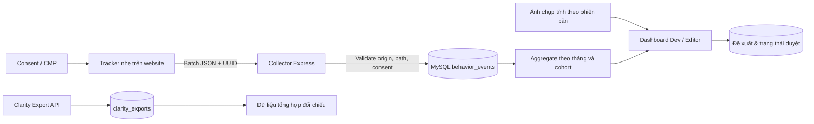

# Thiết kế và triển khai heatmap theo tháng — v1.1

Ngày: 07/10/2026. Tài liệu này mô tả hành vi của bản triển khai mới và điều chỉnh các giả định chưa chính xác ở tài liệu 01–07. Các tài liệu gốc là đầu vào thiết kế; không phải bằng chứng rằng mọi tính năng đã tồn tại hoặc đã được kiểm thử.

## 1. Phạm vi đã triển khai

- Dashboard tiếng Việt ở `frontend/analysis.html`: so sánh hai tháng bất kỳ, cùng website/trang và thiết bị; chọn phiên bản/chiều rộng độc lập cho mỗi tháng.
- Lưới 12 cột, hàng 50px phủ ảnh trang tham chiếu; chế độ điểm chạm, hành động và chênh lệch lượt chạm A−B; phóng to, cuộn đồng bộ, điều khiển bằng bàn phím và xuất CSV.
- Chi tiết ô: tọa độ, vùng nội dung, phần tử có nhãn ổn định, số lượt chạm, số lượt chạm có hành động xác nhận, tên hành động và đường dẫn đích.
- Bảng vùng nội dung: so sánh cả số lượt và tỷ lệ trên 100 lượt xem, cùng lượt xem đã nhìn thấy vùng có đánh dấu.
- Đề xuất thủ công gắn với ô/phiên bản/thiết bị/hai tháng; Admin duyệt và đánh dấu triển khai. Gợi ý kiểm tra theo quy tắc khi một ô có ≥10 lượt chạm nhưng chưa có hành động xác nhận. Không giả lập “AI” hoặc tự sửa nội dung website.
- Đăng ký nhiều website và trang; mỗi site có origin, public key, mục tiêu điều hướng riêng. Hai website có thể cùng dùng `/`.
- Tracker consent-first, retry giữ nguyên UUID, chống đếm trùng trong MySQL, ghi scroll milestone, exposure vùng và xác nhận kết quả.
- Clarity: lưu export tổng hợp làm nguồn đối chiếu, cache 4 giờ, quota 10 request/ngày/project được lưu DB và khóa đồng bộ khi gọi API.

## 2. Quan sát Clarity và Dunnio

Ảnh người dùng cung cấp thể hiện hai heatmap với hai bộ lọc thời gian khác nhau và số lượt xem/lượt chạm. Nó không cung cấp raw events hoặc toàn bộ tọa độ. Bản demo dùng số liệu giả lập 32/29 lượt xem và 17/10 lượt chạm để minh họa luồng UI; không phải bản nhập dữ liệu Clarity.

[Microsoft mô tả Click, Scroll, Area, Attention và Conversion maps](https://learn.microsoft.com/en-us/clarity/heatmaps/heatmaps-overview). [Export API](https://learn.microsoft.com/en-us/clarity/setup-and-installation/clarity-data-export-api) trả dashboard aggregate, chỉ 1–3 ngày gần nhất, tối đa 10 request/ngày/project, tối đa 1.000 hàng và không phân trang. Không có API raw X/Y để dựng lại heatmap tháng 08/2026 hoặc 09/2026.

Đã đọc hướng dẫn REA trong `tool-kit/rea-main/skills/reverse-engineer-anything/SKILL.md`. Nó hướng dẫn dùng công cụ mã nguồn thông thường cho repository đầy đủ; không có runtime Clarity riêng tư hoặc gói ứng dụng cần dịch ngược được cung cấp. Kết luận tính năng Clarity ở đây dựa trên ảnh tham chiếu và tài liệu công khai Microsoft, không tuyên bố đã phân tích mã nội bộ hay truy cập tài khoản Clarity của người dùng.

[Bài viết tham chiếu](https://dunniotailor.com/blog/what-suit-color-to-choose.html) có TOC, nội dung nhiều phần, CTA và related posts. Đường dẫn [Contact công khai](https://dunniotailor.com/contact) là `/contact`, đã thay placeholder `/contact-us` của kế hoạch. Các đường dẫn sản phẩm khác từ seed cũ cần kiểm tra khi chọn triển khai lên website thật.

Ảnh chụp ngày 07/10/2026: desktop 1440px, mobile 390px; là ảnh trang hiện tại, không phải bố cục các tháng lịch sử. Input được che màu trung tính. Không chạy collector trong quá trình chụp.

## 3. Kiến trúc



MVP dùng modular monolith Express + MySQL thay vì thêm hàng đợi hay Redis chưa cần thiết. Report được aggregate bằng SQL với index `(site_id, page_path, device, layout_version, occurred_at)`, action được nối bằng source UUID/session/site/view/viewport và cửa sổ 30 phút. Không đọc toàn bộ raw events vào browser.

Khi lượng dữ liệu tăng: đo EXPLAIN và latency thật; thêm rollup ngày gồm distinct click attribution, partition theo thời gian và job tổng hợp có watermark. Chưa có benchmark 1 triệu sự kiện hoặc cam kết P95 <500ms; đây là bước vận hành tiếp theo sau khi có tải thực tế.

## 4. Ngữ nghĩa dữ liệu

| Chỉ số | Định nghĩa |
|---|---|
| Lượt xem | Một pageview được nhận; resize chiều rộng tạo view segment mới |
| Lượt chạm | Click bằng pointer, tọa độ thực `clientX + scrollX`, `clientY + scrollY`; một UUID một lượt |
| Hành động | Số click nguồn có ≥1 action xác nhận hợp lệ; nhiều action không nhân số click đã chuyển tiếp |
| Tỷ lệ chạm → hành động | `clicks_with_action / clicks × 100`; không có click: null, không hiển thị 0% giả |
| Clicks / 100 views | `clicks / pageviews × 100`; có thể vượt 100 vì một view có nhiều click |
| Delta | A−B; phần trăm tăng chỉ có khi B>0; B=0: null |
| Đã thấy vùng | Distinct view có exposure của vùng `data-track-region`; không chứng minh đã đọc |
| Scroll | Distinct view đã thấy mốc 25/50/75/100% chiều cao tài liệu, không phải thời gian chú ý |

Ba action được hỗ trợ:

1. `navigation`: tracker thấy một link đến mục tiêu, lưu attribution cùng tab, trang mục tiêu thực sự được mở và tracker ở đó đã được consent.
2. `form_success`: tích hợp ứng dụng gọi sau khi response nghiệp vụ báo thành công. Không tính sự kiện submit là form thành công.
3. `customizer_start`: ứng dụng gọi sau khi trình thiết kế đã khởi tạo thành công.

Action phải cùng site/session/path nguồn/view/phiên bản/thiết bị/chiều rộng với click, xảy ra sau click không quá 30 phút. Report gán action cho tháng của click, kể cả action ở đầu tháng kế tiếp. Mỗi loại kết quả được đếm theo distinct source click; một click có thể xuất hiện trong nhiều loại kết quả.

Các tín hiệu này là xác nhận phía trình duyệt. Chưa có webhook đơn hàng hoặc xác nhận giao dịch từ server. Không gọi chúng là doanh thu/đơn hàng hoặc khẳng định một vùng nội dung gây ra chuyển đổi.

## 5. Bố cục, vùng nội dung và so sánh

`col = floor(x / viewportWidth × 12) + 1`, `row = floor(y / 50) + 1`. Không cắt mọi click dưới 5.000px vào hàng 100. Bài Dunnio dài hơn 35.000px, vì vậy dùng SVG phủ ảnh thay vì một canvas khổng lồ hay 8.000 DOM button.

Mỗi lần sửa layout/content đáng kể, tăng `layoutVersion` trong config và chụp snapshot mới. Snapshot đã tồn tại không được ghi đè. Phiên bản cần phân biệt cả ngôn ngữ, variant/A-B hoặc trạng thái trang làm thay đổi hình học. Mỗi tháng phủ ảnh đúng revision/device/width của riêng nó. Tên file có hash đường dẫn để ảnh của hai trang không ghi đè nhau.

Chọn phiên bản A và B độc lập để xem trước/sau thay đổi nội dung. Khi version, width hoặc chiều cao hình học khác nhau, lớp delta từng ô bị tắt và CSV chuyển sang so sánh vùng nội dung. Bảng region vẫn đối chiếu theo identifier ổn định. Không coi C5/R34 ở hai phiên bản khác nhau là cùng nội dung. Note ghi cả hai cohort và đánh dấu ô thuộc A hay B.

Nếu chiều cao sự kiện biến động hoặc khác snapshot, API không trả ảnh để overlay; UI dùng lưới độc lập và cảnh báo. Với accordion, modal, sticky header hoặc nội dung tải động, ưu tiên tên vùng/phần tử ổn định để so sánh nội dung. Grid là tọa độ tài liệu, chưa có mô hình layer riêng cho fixed/sticky elements.

Ô 0 click được gọi “chưa có lượt chạm”, không tự gọi dead zone. Mẫu <100 pageviews có nhắc hạn chế. Ngưỡng này là quy tắc đọc báo cáo, không phải kiểm định thống kê. Gợi ý cải thiện chỉ là giả thuyết cần đo lại, không có cam kết tăng đơn hàng.

## 6. Database và API mới

Migrations 002–006 thêm `tracking_sites`, `tracked_pages`, `behavior_events`, `page_snapshots`, `behavior_notes`, `clarity_exports`. Bảng `click_events`, `grid_cells`, `page_metrics` cũ không trộn vào report đo thật. Migration 004 nhập page registry cũ vào registry có site_id; từ đó đăng ký trang mới qua UI mới hoặc `/api/behavior/pages`. Migration 006 bổ sung hai cohort và period được chọn vào note.

| Method / endpoint | Quyền / chức năng |
|---|---|
| POST `/api/tracker/events` | Public collector: consent=true, siteKey/origin khớp, trang đã đăng ký, 1–50 event, body ≤64KB |
| GET `/api/behavior/catalog` | Đã đăng nhập; sites/pages/layouts/snapshots |
| GET `/api/behavior/compare` | Đã đăng nhập; siteId/path/monthA/monthB/device/version/width, versionB/widthB tùy chọn |
| POST `/api/behavior/sites` | Admin; name/origin/goalPaths |
| POST `/api/behavior/pages` | Admin/Dev; siteId/url/title/category |
| GET/POST `/api/behavior/notes` | Đã đăng nhập; xem và tạo đề xuất |
| PATCH `/api/behavior/notes/:id` | Admin; đổi trạng thái |
| POST `/api/clarity/sync/all` | Admin; lưu một project export, không gọi một lần cho mỗi trang |

Raw events dùng UTC, tháng báo cáo theo `Asia/Ho_Chi_Minh` (UTC+07). Ví dụ tháng 09/2026 là `[2026-08-31T17:00Z, 2026-09-30T17:00Z)`. Dữ liệu quá 24 giờ bị từ chối ở collector để hạn chế timestamp tùy ý; không có API import lịch sử tự khai.

## 7. Cài tracker trên Dunnio

Mở phần “Cài đặt tracking” để sao chép config của site/trang được chọn. Domain của backend phải là HTTPS công khai; localhost không nhận traffic từ khách truy cập internet.

```html
<script>
window.TRACKER_CONFIG = {
 apiEndpoint: 'https://tracker.example.com/api',
 siteKey: 'dunnio-public-v1',
 layoutVersion: 'dunnio-2026-10',
 consent: false,
 sampleRate: 1,
 allowedPaths: [
  '/blog/what-suit-color-to-choose.html',
  '/men/custom-suits',
  '/men/custom-tuxedo',
  '/3d-custom-outfit/suits.html',
  '/3d-custom-outfit/tuxedo.html',
  '/contact'
 ],
 goalPaths: [
  '/men/custom-suits', '/men/custom-tuxedo',
  '/3d-custom-outfit/suits.html', '/3d-custom-outfit/tuxedo.html', '/contact'
 ]
};
</script>
<script defer src="https://tracker.example.com/tracker/behavior-tracker.js"></script>
```

Chạy callback CMP sau khi script sẵn sàng: `window.dunnioTracker.setConsent(true)`. Khi thu hồi: `setConsent(false)`. Nếu consent đã được xác nhận trước lúc load script, có thể khởi tạo `consent: true` từ trạng thái CMP hiện tại. Không mặc định cấp consent cho mọi khách.

```html
<section data-track-region="region-climate">
 <a data-track-key="design-suit-climate" href="/3d-custom-outfit/suits.html">
  Design your suit
 </a>
</section>
<aside data-track-region="related-posts">...</aside>
<form data-track-region="newsletter">
 <!-- Inputs are always excluded; successful callback is explicit. -->
 <button data-track-key="newsletter-submit" type="submit">Submit</button>
</form>
<div data-track-private>...</div>
```

Lưu `clickId = dunnioTracker.getLastClickId()` ngay khi ứng dụng xử lý click. Sau khi request form trả success thật: `dunnioTracker.trackAction('form_success', clickId)`. Tham số sourceId vẫn hợp lệ nếu có click khác trong lúc chờ; context được giữ trong memory tối đa 100 click. Không gọi hook này chỉ vì người dùng đã nhấn nút.

Navigation confirmation v1 áp dụng same-tab, full-document navigation, same-origin và cùng sessionStorage. New-tab, ngoại domain, iframe, SPA route change và keyboard activation chưa có spatial attribution. Scroll/exposure theo vùng được gắn lúc khởi tạo; các vùng chèn sau cần trang/revision phù hợp hoặc bổ sung observer ở phiên bản kế tiếp.

## 8. Bảo mật, riêng tư và SEO

- Backend dùng JWT secret ngẫu nhiên ≥32 ký tự; không dùng fallback secret. bcryptjs cho password; admin tạo bằng CLI, không có admin/admin123.
- Collector kiểm tra Origin với site đã đăng ký, endpoint giới hạn request/IP, body ≤64KB, whitelist loại event/action/keys, dimensions và đường dẫn. UUID unique chống double count. Public key chỉ là định danh site, không phải bí mật xác thực; client telemetry không chống được giả mạo từ HTTP client. Dùng reverse proxy/WAF khi public.
- Không thu text, giá trị input, HTML, CSS selector/id/classes tùy ý, userAgent, referrer, query hoặc fragment. Region/key chỉ là identifier được lập trình viên gắn. Không đưa dữ liệu cá nhân vào tên vùng hoặc đường dẫn. Checkout/account/login/search bị loại trừ. Anonymous session được HMAC trước khi lưu DB; không lưu ID session trình duyệt thô.
- GPC/DNT ngăn gửi telemetry. Consent=false không tạo sessionStorage cho tracker. Thu hồi consent xóa queue và attribution/session cục bộ; không tự xóa dữ liệu đã nhận trước đó.
- Clarity token nằm trong env server ngoài webroot; UI không ghi plaintext token vào DB. Bảng `clarity_tokens` đời cũ không còn được dùng. Nếu một cài đặt trước đây đã có token trong bảng đó, cần xử lý token cũ bằng quy trình quản trị riêng.
- Dashboard mới dùng DOM textContent, CSV escape chống công thức, CSP không chạy inline script, Helmet headers và no-store API. Dashboard đời đầu giữ để tham khảo/quản trị, có nhãn dữ liệu cũ; không dùng nó làm nguồn analytics mới.
- Auth token ở sessionStorage mặc định; chọn ghi nhớ dùng localStorage. Cần bảo vệ tài khoản thiết bị; refresh/revocation/password-change invalidation chưa được xây lại.
- `.htaccess` chặn Apache phục vụ repository trực tiếp. Node chỉ phục vụ frontend và tracker. `robots.txt`, meta noindex và X-Robots-Tag áp dụng tracker dashboard; không sửa robots/canonical/schema của dunniotailor.com.
- Script defer, không thêm overlay vào website thật, không chặn submit/navigation, scroll passive+rAF, batches nhỏ. Chưa đo Core Web Vitals trên production; chưa khẳng định LCP/INP/CLS đạt chuẩn.

Retention mặc định 400 ngày cho measured events nhằm so sánh hơn 12 tháng; khác giả định 90 ngày trong kế hoạch cũ. `npm run retention` xóa dữ liệu hết hạn theo lô, export Clarity sau 90 ngày. Đưa job vào scheduler của môi trường triển khai; không có automation tự tạo ở máy người dùng. Khi xóa raw events, report cho kỳ đó không còn đủ dữ liệu; chưa có archive/rollup giữ báo cáo vĩnh viễn.

## 9. Trạng thái triển khai và phần còn cần môi trường thật

Local review dùng MySQL riêng ở `127.0.0.1:3307`, database `dunnio_review`, cùng Node ở port 3000. Không sửa database Laragon đang dùng. Secrets và tài khoản local nằm ngoài webroot trong `%USERPROFILE%/.codex/local-services/dunnio-review/`.

Các bài kiểm tra được lưu trong `backend/test`: tháng UTC+07, tọa độ trang dài, sanitizer, idempotency, attribution cross-session, role permissions, multi-site paths, UI, CSV, XSS text notes, responsive, axe accessibility, consent, retry, điều hướng và hook thành công. Chỉ báo cáo kết quả chạy thực tế trong bản bàn giao; không kế thừa các dấu “tested” từ tài liệu gốc.

Chưa cài script vào dunniotailor.com production hoặc kết nối Clarity token thật. Để thu dữ liệu thật: publish backend HTTPS, cấu hình origin/goal/paths, cài script+labels+callbacks+CMP, chụp snapshot đúng revision và kiểm tra một hành trình điều hướng/form thật. Sau đó dữ liệu mới bắt đầu tích lũy cho so sánh tháng. Heatmap lịch sử chỉ dùng dữ liệu đã có nguồn tọa độ đáng tin; không backfill bằng ước lượng Clarity.
