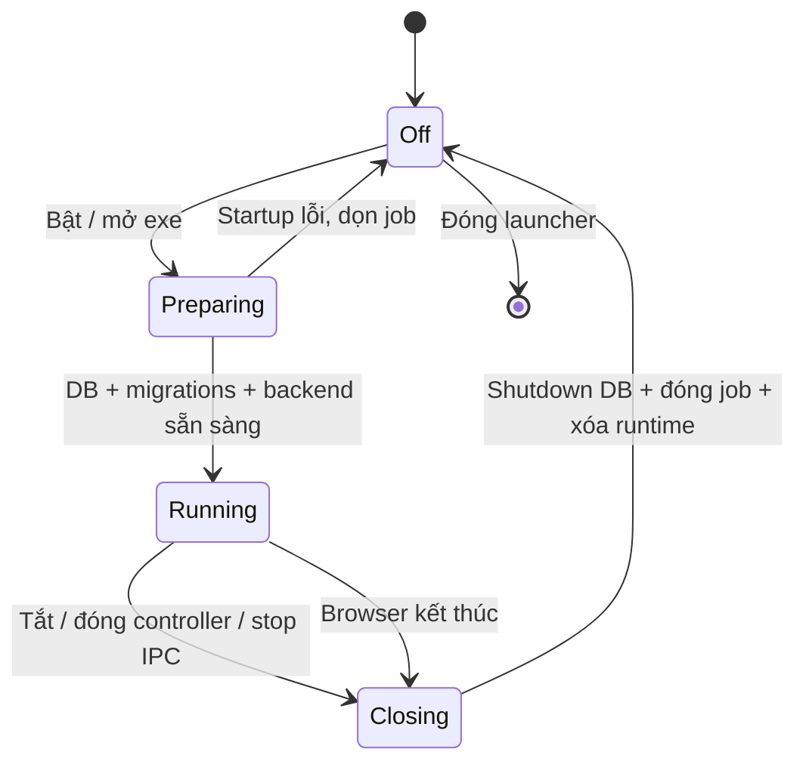

# Dunnio Insights Desktop 1.3.2 — Thiết kế đóng gói Windows

Ngày: 07/10/2026. Mục tiêu: bật/tắt ứng dụng local với quyền Admin, đóng sạch tài nguyên của phiên, giữ dữ liệu cần cho lần dùng tiếp theo.

## Phương án

Launcher WinForms x64 (.NET Framework 4.8) quản lý Node.js 24.19.0, MySQL 8.4.3 và một cửa sổ Edge riêng. Node/MySQL được kèm trong gói, không phụ thuộc PATH/Laragon/Node/MySQL cài sẵn. Windows 10/11 x64 cần .NET Framework 4.8 và Edge; Microsoft C++ Redistributable ký số được kèm để xử lý prerequisite còn thiếu khi người dùng hoàn tất UAC. Máy kiểm thử đã có C++ runtime phù hợp; chưa thử bộ cài prerequisite trên VM sạch.

Gói portable ZIP có executable, runtime, source ứng dụng, license material, manifest hash từng file và hash ZIP. `Install.vbs` gọi executable `--install` để copy vào LocalAppData/Programs và tạo shortcut. Không tạo service, auto-start, scheduled task, rule firewall hay thay đổi PATH. Executable chưa ký Authenticode; không giả lập trusted-publisher và không có cơ chế vượt qua SmartScreen.

## Quyền Admin

- Windows owner mở app sẽ được cấp phiên **Admin trong Dunnio Insights** qua ticket một lần, 30 giây. Ticket trong fragment được xóa trước khi exchange; JWT chỉ lưu sessionStorage trong profile tạm.
- Endpoint quản trị lifecycle yêu cầu capability 256-bit riêng theo phiên và loopback; origin khác bị từ chối. Capability không gửi xuống frontend, không ghi vào owner/state file.
- Windows process mặc định `asInvoker`; khi cần quyền hệ điều hành có thể dùng Run as administrator. Không tự mở mọi process ở elevated token để quản trị local DB.
- Config/password/API token bảo vệ bằng [Windows DPAPI CurrentUser](https://learn.microsoft.com/en-us/dotnet/api/system.security.cryptography.dataprotectionscope). Thư mục dữ liệu có ACL theo owner/SYSTEM/Administrators. ZIP không chứa credential hoặc database cá nhân.

## Vòng đời

Native CreateProcess khởi tạo suspended, gán vào Job trước khi resume. Job đặt [KILL_ON_JOB_CLOSE](https://learn.microsoft.com/en-us/windows/win32/procthread/job-objects), áp dụng cho cây process. Không dùng `taskkill /IM node.exe`, không tác động browser/DB của ứng dụng khác. Mutex theo Windows SID + data root chặn hai controller tranh cùng data directory.

Đóng bình thường: đóng cửa sổ Edge thuộc job, dừng HTTP requests, đóng idle/active connections theo timeout, đóng MySQL pool và gửi SQL SHUTDOWN. Job là lớp thu hồi cuối cùng nếu thành phần không thoát. Bản GUI có IPC `--stop` để người dùng hoặc bài kiểm thử local dừng cùng luồng chuẩn. Tắt, đóng controller hoặc đóng Dashboard đều dừng và thoát controller sau khi dọn phiên, giải phóng mutex.

Bản 1.3.2 kiểm tra quyền sở hữu mutex bằng `WaitOne(0)` và xử lý `AbandonedMutexException`, thay cho kiểm tra object vừa được tạo. Một handle khác còn giữ named mutex sau khi owner chết không làm lần mở sau báo nhầm “đã chạy”. Mở shortcut khi owner đang chạy gửi activation event theo tài khoản/workspace: mở lại Dashboard của owner hoặc khởi động lại backend đã dừng, không tạo phiên dữ liệu song song. Yêu cầu activation được giữ trong lúc startup đang bận. Chế độ kiểm thử/headless vẫn từ chối phiên trùng với exit code 3.

Giám sát Dashboard dùng cửa sổ Edge visible thuộc Job (kể cả minimized), có grace period lúc khởi động và xác nhận qua hai nhịp timer. Không dùng số tiến trình helper để xác định đóng. Kiểm tra ownership dùng quyền PROCESS_QUERY_LIMITED_INFORMATION theo [IsProcessInJob](https://learn.microsoft.com/en-us/windows/win32/api/jobapi/nf-jobapi-isprocessinjob), không yêu cầu toàn quyền trên tiến trình Edge. Lỗi dịch vụ giữ launcher với trạng thái/mã thoát; monitor lỗi không tự quyết định đóng. `lifecycle.jsonl` được giới hạn khoảng 16 KB; `last-backend-error.json` chỉ giữ lỗi gần nhất (type/code và vị trí source, loại message/secret).

Sau khi browser của phiên kết thúc và không còn helper, timer tự tắt backend/DB. Đã kiểm thử khởi tạo browser riêng và stop IPC dọn browser/cache. Đường input trực tiếp vào cửa sổ bị công cụ Computer Use dừng vì không xác minh được URL; chưa xác nhận thao tác bấm X bằng công cụ đó. Không dùng công cụ UI thay thế để vượt qua giới hạn này.

Đóng đột ngột: OS đóng handle Job và kết thúc child processes. Cache trên đĩa có thể còn nếu kill/mất điện; lần mở sau dọn runtime cũ và InnoDB crash recovery. Không thể chạy cleanup khi máy đã mất điện. Không hứa RAM hệ điều hành bằng 0: Windows filesystem cache do OS quản lý; mục tiêu là không còn process Dunnio chạy nền và không còn cache phiên khi đóng chuẩn.

## Dữ liệu và file

| Loại | Vị trí | Khi đóng |
|---|---|---|
| Config/secret | LocalAppData/DunnioInsights/settings.protected | Giữ, DPAPI |
| Database | LocalAppData/DunnioInsights/data/mysql | Giữ |
| Backup user tạo | LocalAppData/DunnioInsights/backups | Giữ |
| Profile/cookie/cache/session | runtime/session/browser | Xóa |
| Log/dump import/backup partial | runtime/session | Xóa |
| Source review cũ | .codex/local-services/dunnio-review | Giữ để rollback; không phải dependency Desktop |

Cleanup chỉ trong child đã kiểm tra của app runtime; không đi qua junction/reparse point. Backup được ghi `.partial` trong runtime và chỉ rename ra backup bền vững sau khi mysqldump + gzip thành công. Đóng trong backup có thể hủy công việc để shutdown, không để lại backup hoàn thành giả. Port HTTP/DB được chọn còn trống, bind 127.0.0.1; không nối/kết thúc instance DB đang tồn tại.

Lần đầu trên thiết bị này đã chuyển dữ liệu review bằng mysqldump single-transaction vào database Desktop. Kết quả đối chiếu: 1 user, 51 tracked pages, 0 measured events, 1 Clarity export, 2 snapshots. Clarity token đã có được import vào DPAPI. Không tạo số liệu hành vi giả trong database.

## Kiểm thử thực tế

Báo cáo JSON dưới `.local/qa/windows-lifecycle.json`, `windows-user-import.json`, `windows-user-recovery.json` và các báo cáo self-test:

- Mở/đóng và mở lại: pass; Admin role, ticket replay bị chặn, controller endpoint yêu cầu secret.
- Backup gzip: pass; process Node/MySQL thoát, runtime directory bị xóa, database/settings được giữ, JWT secret không xuất hiện plaintext trong file DPAPI.
- Instance thứ hai: bị từ chối với exit code 3, không tạo DB/browser thứ hai.
- Kill controller: các child processes thoát; mở lại phục hồi MySQL và dọn runtime cũ.
- GUI lifecycle qua stop IPC: controller thoát, browser riêng bị đóng, cache profile bị xóa.
- Import người dùng: Clarity configured=true, số lượng các bảng được giữ; sau forced termination + recovery không thay đổi các counts.
- Backend regression: 7/7 pass. Browser regression: 6/6 pass, gồm axe trên desktop/mobile; đây là test web app, không phải kiểm tra hình ảnh launcher native.
- Payload credential scan: không tìm thấy token/DB password/JWT secret/admin password thật trong gói. Production npm audit: 0 vulnerability tại thời điểm build.

Trên máy này, warm startup khoảng 1,6 giây; self-test gồm backup + stop khoảng 3–5 giây. Working set được đọc ở thời điểm chạy: Node khoảng 69–72 MB, MySQL khoảng 24–43 MB, chưa gồm browser/controller. Không coi đây là benchmark trên mọi thiết bị hoặc mọi tải.

Giới hạn chưa xác minh: giao diện native bằng Computer Use, VM Windows sạch/prerequisite install, máy enterprise policy ép Edge UserDataDir, certificate signing và tải lớn. Application-local loopback không trở thành collector HTTPS cho khách hàng ngoài internet; bản Desktop dùng API Clarity outbound và dữ liệu local đã có.

## Kiểm thử bổ sung cho 1.3.2

Ngày 07/10/2026: mutex abandoned vẫn còn handle, mở shortcut lần hai, controller có backend đã dừng, nút Tắt qua handler WinForms thật (hai chu kỳ), crash Edge trong khi chụp ảnh và stop IPC đều pass. Lỗi browser/service giữ controller và ghi mã lỗi. Test `desktop/test-native-options.ps1` chạy cửa sổ Edge riêng cùng MainWindow thật trên bản sao dữ liệu offline: chọn nhóm bằng popup/keyboard 24 lần, tổng 31 thay đổi option (nhóm/thiết bị/zoom), đổi tháng và so sánh; không JavaScript error, backend vẫn trả 200, đóng cửa sổ dọn runtime. Bản cũ 1.3.1 cũng không tái hiện lỗi option ở bài này; chưa có log của lần user gặp lỗi nên không kết luận chắc nguyên nhân lịch sử. Bản mới bổ sung chẩn đoán giới hạn và giám sát cửa sổ thay cho PID/helper.

Kiểm thử Node: 11/11 pass, gồm xác nhận chẩn đoán crash không ghi secret/message. Package lock đã đối chiếu 110 dependency với metadata thực tế; build từ npm cache mới không có integrity/version mismatch. Manifest loại chính manifest khỏi danh sách hash để không có self-reference khi build incremental. Gói hiện hành: `dist/DunnioInsights-1.3.2-win-x64.zip`.

## Bàn giao trên thiết bị (ghi nhận bản 1.2.0)

Đã cài tại `%LOCALAPPDATA%/Programs/DunnioInsights`, tạo shortcut Desktop và Start Menu. Đã dừng backend/MySQL review nguồn, rồi kiểm tra bản cài vẫn khởi động độc lập và giữ nguyên counts/Clarity configured. Ứng dụng được để ở trạng thái tắt; runtime phiên chính không còn thư mục.

ZIP: `dist/DunnioInsights-1.2.0-win-x64.zip` (111.622.446 bytes). SHA-256 được lưu trong file `.zip.sha256`. Manifest kiểm tra 2.700 file: 0 hash mismatch, 0 credential thật tìm thấy trong payload.

Thao tác dọn dữ liệu fixture tại `%LOCALAPPDATA%/DunnioInsights-PackagingTests` bị kiểm duyệt tự động của công cụ thực thi từ chối với thông báo “blocked by policy”, kể cả khi đã kiểm tra đường dẫn cố định và không có reparse point. Đã dừng thử xóa. Các database/config test dùng --fresh còn ở thư mục đó; chúng không chạy và không thuộc runtime ứng dụng chính. Không chuyển sang công cụ khác để vượt qua chặn này. Báo cáo QA trong `.local/qa/` được giữ để đối chiếu.
