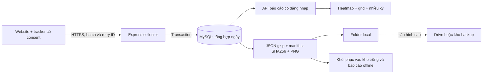

# Dunnio Touch 1.5 — vận hành, kiểm thử và máy chủ

Ngày xác minh: 11/10/2026. Quyết định của người dùng: lưu local trước; chưa có VPS/domain; cấu hình Drive/GitHub sau. Tài liệu này mô tả mã nguồn đã triển khai. Các tài liệu 01–07 là kế hoạch đời đầu, không thay thế hợp đồng Order 3.

## Kết quả đã triển khai

`/touch.html` là màn hình mặc định sau đăng nhập. Tracker riêng ghi click/tap bằng Pointer Events, tổng hợp theo ngày, trang, thiết bị, layout và chiều rộng CSS. Heatmap có số lượt, lưới 12 cột × hàng 50 px, bảng phần tử và vị trí. Có 1–12 khoảng ngày, nhóm A/B nhiều tháng, chênh lệch số lượt, phần trăm và lượt chạm/100 lượt xem. Có xuất CSV/JSON, daily archive gzip và khôi phục local; Clarity Workspace ở `/analysis.html` vẫn giữ dữ liệu cũ.

Đây là dữ liệu thu mới từ website có cài tracker. Không tái tạo được tọa độ lịch sử Clarity bằng token. Các tháng 5–8/2026 trong demo/kiểm thử là fixture, không phải hành vi khách hàng Dunnio. Chưa gắn mã lên website production.

## Cấu trúc và ngữ nghĩa



Đếm số lần tương tác được nhận; không có tính năng unique users, session replay hoặc đo mọi chuyển động con trỏ. SDK chống đếm kép touch/click, bỏ drag/scroll, có DNT/GPC và consent. Hành vi bàn phím chưa được tính thành tap. API public key/origin không chứng minh người thật; bot hoặc request giả vẫn có thể làm sai số liệu. Không lưu IP/session/user ID vào các bảng mới hoặc archive; hệ điều hành/proxy vẫn có thể có log riêng.

Điểm tuyệt đối được gom vào bucket 20 px, chia tiếp tại ranh giới ô lưới. Bubble hiển thị vị trí đại diện bucket, không phải tọa độ từng tap chính xác đến pixel. Tổng số lượt của bucket được giữ. Điểm tương đối trong phần tử có lưới 20 × 20. Khuyến nghị gắn `data-track-key` ổn định và `data-track-region` cho CTA, ảnh, menu, mục bài viết. Không đặt dữ liệu cá nhân trong key. Key fallback từ cấu trúc DOM có độ tin cậy thấp hơn và không ghép qua layout khác.

Phần tử fixed dùng mặt phẳng viewport riêng. Giao diện chỉ phủ ảnh khi version, device, chiều rộng và chiều cao khớp; nếu thiếu ảnh/geometry khác thì hiển thị lưới độc lập. Bounds và centroid giải thích vị trí phần tử; ΔX/ΔY chỉ hiện khi geometry tương thích. So sánh khóa explicit qua layout khác giữ được số lượt, không tự khẳng định dịch chuyển tọa độ. Snapshot hiện tại không đại diện cho giao diện đã thay đổi trong quá khứ. Công cụ capture tích hợp hiện hỗ trợ trang công khai `https://dunniotailor.com`; các origin khác vẫn thu được số liệu/lưới nhưng chưa có capture tự động tổng quát.

Chiều cao thay đổi do lazy load không làm tăng pageview. Đổi đường dẫn hoặc chiều rộng tạo một đoạn lượt xem mới; mẫu số là lượt xem theo chiều rộng, không phải số người. Tổng qua nhiều chiều rộng có thể đếm cùng một lần truy cập nhiều lần. Document cuộn ngang vượt viewport chưa hỗ trợ: SDK bỏ và báo `unsupportedGeometryCount`. Counts khi sampling là số lượt thực nhận, không nhân ngược để giả định tổng dân số.

Ngày kết thúc được lấy trọn ngày UTC+07. Kỳ A/B không chồng lấn. B−A là chênh lệch; A=0 không chia ra Infinity. Kỳ thiếu dữ liệu giữ trạng thái thiếu; có pageview và 0 tap mới là số 0 đã quan sát. Report tối đa 10.000 points/kỳ và báo `truncated`; archive giữ đầy đủ aggregates. Số vượt `Number.MAX_SAFE_INTEGER` được archive dưới dạng chuỗi thập phân; report từ chối thay vì làm tròn im lặng.

## Chạy local

Windows: giải nén gói 1.5, mở `DunnioInsights.exe`. Node/MySQL đi kèm; không cần thay đổi Laragon. Dữ liệu Desktop nằm trong `%LOCALAPPDATA%/DunnioInsights`; bản mới nâng cấp schema và giữ dữ liệu cũ. Đóng app sẽ dừng collector local. Local loopback không nhận được traffic từ khách truy cập website ngoài internet.

Chạy từ source:

```powershell
cd C:\laragon\www\dunnio-behavior-tracker\backend
$env:DOTENV_CONFIG_PATH = 'C:\private\tracker.env'
npm ci
npm run migrate
# Chỉ tạo admin khi database mới, đã đặt INITIAL_ADMIN_PASSWORD riêng >=12 ký tự.
npm run admin:create
npm start
```

Env theo `backend/.env.example`: DB_HOST/PORT/NAME/USER/PASSWORD, JWT_SECRET ngẫu nhiên ≥32 ký tự, CORS_ORIGIN đúng dashboard, HOST/PORT. Secrets nằm ngoài webroot. Đối với instance review hiện có, dùng `start-local.ps1` ở root; secrets và thông tin truy cập đã lưu ngoài source trong `%USERPROFILE%/.codex/local-services/dunnio-review/`. Không chạy admin:create để ghi đè tài khoản hiện có.

## Gắn mã và kiểm tra thu thập

1. Đăng nhập `/touch.html`, mở Cài đặt thu thập, đăng ký website origin và các trang công khai.
2. Chọn trang/device/version/width; sao chép snippet từ giao diện. Cấu hình trước khi tải SDK:

```html
<script>
window.DUNNIO_TOUCH_CONFIG = {
  apiEndpoint: 'https://collector.example.com/api',
  siteKey: 'PUBLIC_KEY_FROM_SETUP',
  layoutVersion: 'release-1',
  consent: false,
  allowedPaths: ['/blog/example.html'],
  sampleRate: 1
};
</script>
<script defer src="https://collector.example.com/tracker/touch-tracker.js"></script>
```

3. CMP gọi `window.dunnioTouch.setConsent(true)` khi người dùng đồng ý; thu hồi dùng `setConsent(false)`. Nếu SDK chưa tải, gọi sau load. Với CSP của website, cho phép script-src/connect-src tới collector; consent wiring do website thực hiện. Endpoint HTTPS phải đang chạy.
4. Gắn nhãn ví dụ `<button data-track-key="consult-button" data-track-region="article">…</button>`. Tăng layoutVersion khi thay bố cục và chụp ảnh tương ứng.
5. Thử tap, xem `dunnioTouch.getState()` và Network POST `/api/tracker/touch`; gọi `flush()` để thử gửi ngay. Kết quả 202; retry cùng batch ID không cộng lần nữa. Cùng ID khác nội dung bị 409. Collector không nhận backfill tháng cũ: timestamp chỉ trong 24 giờ, lệch tương lai tối đa 5 phút.
6. Chọn ngày hôm nay trong app, đúng origin/page/device/version/chiều rộng. SDK không đảm bảo 100% mọi tương tác: consent, DNT/GPC, adblock, mạng và đóng tab có thể gây thiếu. Queue có giới hạn và báo droppedCount. Receipt lưu 72 giờ; không retry vô hạn.

API local là API của ứng dụng này, không có phí theo event hay quota của nhà cung cấp analytics. Tài nguyên máy chủ, ổ đĩa, bandwidth và backup vẫn có chi phí. Collector mặc định 120 request/IP/phút; gửi batch thay vì một request/tap. NAT nhiều người chung IP cần đo rồi điều chỉnh `TOUCH_INGEST_LIMIT`, không dùng giá trị benchmark 6000 làm mặc định production.

## Archive hằng ngày và khôi phục

Trong `backend`, sau khi đặt DOTENV_CONFIG_PATH:

```powershell
npm run touch:archive -- export --date 2026-10-10
npm run touch:archive -- export --date 2026-10-10 --site 1 --directory C:\DunnioArchives
npm run touch:archive -- verify --file C:\DunnioArchives\touch-2026-10-10-site-1-HASH.json.gz
npm run touch:archive -- restore --file C:\DunnioArchives\touch-2026-10-10-site-1-HASH.json.gz
npm run touch:maintenance
```

Tên HASH là digest thực được command trả về. Luôn giữ `.json.gz` cùng `.manifest.json`. Export gồm 3 bảng aggregates, metadata site/page, PNG của các layout/device/width được dùng trong ngày. Không gồm mật khẩu, public key cũ, token, tài khoản hay receipt từng batch. Archive chưa thay thế full database backup cho tài khoản/Clarity/cấu hình.

Mặc định source xuất vào `.local/touch-archives`; Desktop dùng `<DESKTOP_DATA_ROOT>/touch-archives`, có thể đổi TOUCH_ARCHIVE_DIR. Mỗi file tối đa 256 MiB trước nén; ngày lớn chia theo site. Ảnh được nhúng lại trong từng archive ngày để khôi phục độc lập, do đó ảnh có thể chiếm phần lớn dung lượng. Phiên bản export có nội dung thay đổi sẽ tạo file mới; người vận hành chọn giữ revision cần thiết sau khi kiểm chứng backup.

Maintenance xuất hôm qua và ngày trước nữa vì batch trễ có thể đến trong 24 giờ; xóa receipt quá 72 giờ, giữ nguyên aggregates. Có thể copy cả hai file tới folder local khác bằng TOUCH_BACKUP_FOLDER. Không tự xóa lịch sử số liệu. Theo dõi disk và đẩy archive ra đích ngoài máy sau khi cấu hình.

Nếu lịch dừng lâu hơn hai ngày, các ngày cũ vẫn còn trong database nhưng cần export từng ngày bị bỏ lỡ bằng CLI; maintenance hiện không tự backfill toàn bộ khoảng downtime.

Restore yêu cầu database đã migrate và site/ngày đích không có số liệu; không gộp hoặc ghi đè kho đang thu. Site ID được ánh xạ theo origin, site mới có public key mới. Không cài lại key cũ vào website khi restore vào máy phân tích offline. Cùng archive nhập lại không tăng số; snapshot khác nội dung không bị ghi đè. Kiểm thử đã dùng kho site trống trong MySQL review; thử tạo database hoàn toàn mới bị quyền `dunnio_review` từ chối CREATE DATABASE nên chưa xác minh cách đó trên host này. Quy trình production phải thử restore vào database QA riêng trước khi dùng chính thức.

Windows source có helper `deployment/archive-local.ps1 -EnvironmentFile C:\private\tracker.env [-BackupFolder C:\Backups]`. Có thể tạo Task Scheduler 02:15 hằng ngày với tài khoản có quyền đọc env và Node: `powershell.exe -NoProfile -File C:\...\deployment\archive-local.ps1 -EnvironmentFile C:\private\tracker.env`. Dịch vụ MySQL phải đang chạy, máy phải bật; gói Desktop dùng cổng động và dừng DB khi đóng nên không áp dụng một env source tĩnh để kết nối Desktop. Chưa cài Task Scheduler lên máy người dùng. Nên đặt lịch trên collector VPS chạy liên tục.

## Máy chủ đề xuất và triển khai

Chọn VPS Linux x64 với SSD/NVMe, Docker Compose, HTTPS và MySQL 8.4. Shared hosting chỉ chạy PHP không phù hợp Express/headless Chromium và tác vụ nền. 20–50 trang/tháng chưa xác định được tải: cần traffic đồng thời, số batch, số geometry/layout riêng, số điểm/element riêng và dung lượng ảnh.

| Mục đích | Cấu hình bắt đầu | Giá tham khảo DigitalOcean Basic Regular |
|---|---|---|
| Pilot và traffic nhỏ/vừa, chụp ảnh tuần tự | 2 vCPU, 4 GiB RAM, 80 GiB SSD | $24/tháng |
| Nhiều layout/điểm, báo cáo hoặc chụp ảnh thường xuyên | 4 vCPU, 8 GiB RAM, 160 GiB SSD | $48/tháng |

Giá xác minh 11/10/2026 trên [bảng giá chính thức](https://www.digitalocean.com/pricing/droplets); chưa gồm thuế, backup bổ sung, domain và bandwidth vượt gói. Đề xuất là cấu hình pilot để kiểm chứng, chưa phải cấu hình đã benchmark trên VPS. Không chọn gói 1 GiB cho app+MySQL+Chromium cùng máy. Với 4 GiB, compose giới hạn DB 1600 MiB, app 1600 MiB, Caddy 128 MiB; MySQL buffer pool 1 GiB, Node heap 512 MiB, chỉ 1 capture tại một thời điểm. Cần quan sát RSS cả Chromium, không chỉ Node.

Các file deployment đã chuẩn bị: Dockerfile Node 24 + Chromium, compose MySQL/Express/Caddy, Caddyfile, env mẫu, systemd timer 02:15 Asia/Ho_Chi_Minh. Database không publish port; app sau proxy dùng TRUST_PROXY_HOPS=1. Cấu hình proxy này chỉ an toàn khi app không được mở trực tiếp ra internet ngoài proxy. Chưa chạy Docker vì máy hiện không có Docker; đã rà soát cấu hình và đường dẫn, chưa xác minh image build hay timer trên Linux.

Khi đã có VPS/domain và DNS trỏ tới VPS:

```sh
cd /opt/dunnio/deployment
cp .env.example .env
# Sửa APP_DOMAIN; đặt DB_PASSWORD, DB_ROOT_PASSWORD và JWT_SECRET riêng ngẫu nhiên.
docker compose config --quiet
docker compose up -d --build
docker compose exec -T -e INITIAL_ADMIN_PASSWORD='UNIQUE_PASSWORD_AT_LEAST_12_CHARS' app node src/createAdmin.js
curl --fail https://YOUR_DOMAIN/api/health
sudo cp dunnio-archive.service dunnio-archive.timer /etc/systemd/system/
sudo systemctl daemon-reload
sudo systemctl enable --now dunnio-archive.timer
systemctl list-timers dunnio-archive.timer
```

Không dùng mật khẩu minh họa; nên truyền password qua secret/envfile thay vì để trong shell history. Giữ `.env` ngoài Git và chỉ tài khoản vận hành đọc được. Mở firewall 80/443, giới hạn SSH theo cơ chế quản trị của VPS. HTTPS phải hoạt động trước khi gắn tracker vào website. Xuất archive thử và restore QA; kiểm tra receipt retry, NAT limiter, 4 kỳ báo cáo và chụp ảnh thực. Thử tải trên VPS test riêng, không chạy script fixture có quyền ghi/xóa dữ liệu QA vào kho production.

Mục tiêu pilot: collector p95 dưới 250 ms ở tải dự kiến, không sai tổng/retry, report 4 kỳ đáp ứng dưới 2 giây trên bộ dữ liệu mục tiêu, RAM dưới 75%, disk dưới 70%. Đây là tiêu chí cần đo, không phải số đã đạt trên VPS. Sau 7–14 ngày, dùng tốc độ tăng dữ liệu/ngày và dung lượng snapshot/archive thực để chọn retention/nâng cấu hình. Lịch sử và unique geometry vẫn tăng dung lượng dù nhiều tap cùng điểm chỉ tăng counter.

## Đích Drive/GitHub sau này

Local copy hỗ trợ một folder Google Drive đã đồng bộ: đặt TOUCH_BACKUP_FOLDER tới folder đó. Việc app copy thành công không chứng minh Drive đã upload; kiểm tra sync status hoặc download/verify một file từ đích. Linux có thể cấu hình rclone Drive riêng rồi dùng `rclone copy /path/to/touch-archives remote:folder`; [tài liệu chính thức](https://rclone.org/drive/) mô tả OAuth/service account và giới hạn backend. Credentials để ngoài source; hiện chưa cài/cấu hình hoặc truyền dữ liệu lên Drive.

GitHub phù hợp code và manifest nhỏ trong repo private, không phù hợp kho database/PNG/gzip tăng mỗi ngày. GitHub cảnh báo file >50 MiB và chặn file >100 MiB theo [tài liệu chính thức](https://docs.github.com/en/repositories/working-with-files/managing-large-files/about-large-files-on-github). Gzip đã nén làm Git history nhanh phình. Nếu cần tập trung dữ liệu, ưu tiên Drive/object storage; không commit token hoặc credentials. Chưa tạo repo/upload nào.

## Bằng chứng đã chạy

Máy local: Windows 10, Ryzen 5 5600H, 12 logical CPU, RAM 31,35 GiB, Node 24.19.0, MySQL 8.4.3; browser Chrome/Edge 155.

| Kiểm thử | Kết quả |
|---|---|
| Unit + HTTP/MySQL + archive + real Chrome E2E | 22/22, không skip |
| Hồi quy chức năng cũ và Clarity | 21/21, không skip |
| SDK Chrome/Edge, consent, retry, SPA, geometry, fractional sampling | 28/28 |
| UI desktop/mobile, lỗi/thiếu dữ liệu, comparison và axe | 8/8 |
| Thực sự bấm trang fixture bằng Chrome touchscreen | 1 pageview, 4 tap, trong đó 1 fixed; MySQL đúng tổng |
| 4 tháng fixture qua API và UI thật | A=30, B=60, Δ=30, +100% |
| Archive có PNG và restore/retry | Số liệu/ảnh giữ nguyên, không cộng trùng |
| BIGINT trên MySQL → gzip → restore | Giữ chính xác 9007199254740993 |
| Windows launcher 1.5 | Lifecycle, crash recovery, cleanup, shortcut và Off/reopen đều passed |
| Maintenance CLI local | Xuất 09–10/10/2026, kho điểm chạm hai ngày đó trống; manifest hợp lệ |

Benchmark actual HTTP/MySQL, fixture 50 URL, 6 request đồng thời:

| Bài đo | HTTP request | Thời gian | p95 | Lỗi | Tổng tap trọng số |
|---|---:|---:|---:|---:|---:|
| 300 batch ×30 points×count10; 15 retry | 315 | 3,80 s | 97,02 ms | 0 | 90.000 |
| 600 batch ×99 points×count10; 30 retry | 630 | 9,39 s | 116,03 ms | 0 | 594.000 |

Lần lớn chạy cùng lúc một phần QA launcher. Peak Node RSS 227/255 MiB gồm load generator và server chung tiến trình. Count10 là trọng số fixture, không phải benchmark 594.000 pointer events độc lập. Các điểm lặp theo tập hữu hạn; chưa đo worst-case điểm/geometry riêng, soak nhiều giờ hay VPS/container. information_schema size là thống kê ước tính toàn bảng nên không dùng làm dự báo dung lượng mỗi event.

Bằng chứng lưu trong `test-results/touch-load*.json`, `test-results/touch-e2e/evidence.json`, screenshot và các báo cáo Playwright. Chạy lại: `npm test`, `npm run test:touch`, `npm run test:touch:db`, `npm run test:touch:e2e`, `npm run test:touch:collector`, `npm run test:touch:ui`. Với DB tests đặt RUN_DB_TESTS=true và DOTENV_CONFIG_PATH vào môi trường QA. Không bao gồm secrets trong bằng chứng.

Pointer Events được chọn theo [MDN](https://developer.mozilla.org/en-US/docs/Web/API/Pointer_events), kết hợp kiểm thử native touch, drag và scroll để tránh dùng đồng thời touch/click gây đếm kép. Tài liệu API khảo sát: [PostHog heatmaps API](https://posthog.com/docs/api/heatmaps), [Matomo HeatmapSessionRecording Reporting API](https://developer.matomo.org/guides/reporting-api#ModuleHeatmapSessionRecording). Mã nguồn hiện không phụ thuộc hai dịch vụ này.
