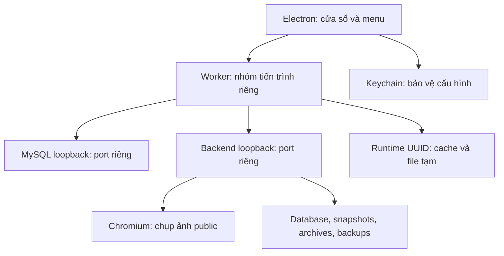

# macOS 1.5.0 và repository GitHub

Ngày 13/10/2026. Repository: https://github.com/tahieu98/dunnio-user-behavior-tracker.

## Cấu trúc và tương thích

Windows giữ launcher WinForms/DPAPI/Windows Job Object. macOS bổ sung `desktop/macos`: Electron 44.7.0, safeStorage/Keychain và worker POSIX riêng. Frontend, Express/MySQL, SDK và migrations 001–013 dùng chung; không chuyển MySQL sang database khác và không thay đổi dữ liệu Windows để tạo bản Mac.

Hai gói native: arm64 và x64. Khai báo macOS tối thiểu 14.0 theo binary MySQL; build và kiểm thử thực tế trên GitHub runners macOS 15 (Apple Silicon/Intel). Chưa chạy trực tiếp trên máy người dùng hoặc macOS 14. MySQL 8.4.3 được pin SHA-256 từ archive Oracle cho từng kiến trúc; Chromium/Node được kèm nên không cần Homebrew, DB service hay trình duyệt cài sẵn. Cập nhật runtime phải kiểm tra lại checksum/kiến trúc/minimum OS và kiểm thử đầy đủ.

## Vòng đời và bảo mật

Chỉ một instance ứng dụng. Mở lần hai focus cửa sổ hiện tại. Đóng cửa sổ cuối/Command+Q dừng backend, shutdown MySQL và kết thúc nhóm tiến trình worker. Worker nhận IPC disconnect khi launcher force quit; trong luồng đó tự dọn nhóm của mình. Không killall/pkill, không tạo Login Item, không tự restart khi lỗi. Cache xóa sau khi child processes dừng; dữ liệu bền vững ở `~/Library/Application Support/Dunnio Insights` được giữ.

Renderer sandbox, contextIsolation, nodeIntegration=false. Chỉ điều hướng nội bộ về origin loopback của phiên; HTTPS external mở bằng trình duyệt hệ thống. Cấu hình Clarity đi qua preload bridge riêng có kiểm tra sender, lưu encrypted Keychain. Không import Windows settings.protected hoặc token vào bộ cài. API controller cần secret; phiên Admin dùng ticket một lần. Snapshot collector và API Clarity giữ cùng giới hạn dữ liệu như Windows.

Preview dùng ad-hoc signature, chưa có Developer ID/notarization. Keychain có thể hỏi lại quyền khi đổi build; bản phân phối production nên dùng chữ ký Developer ID nhất quán. Không có cơ chế tắt Gatekeeper/quarantine. Smoke test dùng random credentials trong thư mục fixture tạm, không dùng Keychain hay dữ liệu thật và không gọi API Clarity.

## Kiểm thử và xuất bản

- Local: 6 bài vòng đời/bảo mật Mac, 19 unit backend và 19 Touch pass. Hai integration test mặc định skip khi chưa cấu hình DB fixture.
- Native CI: backend/migrations/admin, khóa API controller, ticket replay, backup, tải Touch/Clarity UI, hai chu kỳ mở/đóng và force quit guardian/Node/MySQL/cache.
- Kiểm tra chữ ký: `codesign --verify --deep --strict` trên gói `.app`.
- Gói DMG/ZIP và SHA256SUMS được tạo riêng mỗi kiến trúc. Release chỉ chạy khi cả hai job thành công.
- Workflow: https://github.com/tahieu98/dunnio-user-behavior-tracker/actions/runs/38331068571. Commit ứng dụng được build: `ddca8536f411e2dece00d5f655d2f45b1b78dace`.
- Release dự kiến của workflow: https://github.com/tahieu98/dunnio-user-behavior-tracker/releases/tag/v1.5.0-macos-preview. Chỉ coi đã phát hành khi workflow release job thành công và assets hiện trên trang này.

Publication audit: 183 file source lúc import đã được kiểm tra với credentials Windows đang dùng; không có match. `.local`, `dist`, node_modules, .env thật, settings.protected/settings.keychain, khóa ký và SQL backup nằm ngoài Git. Repository có package locks và hướng dẫn build; binary được đưa lên Releases, không vào lịch sử Git.
